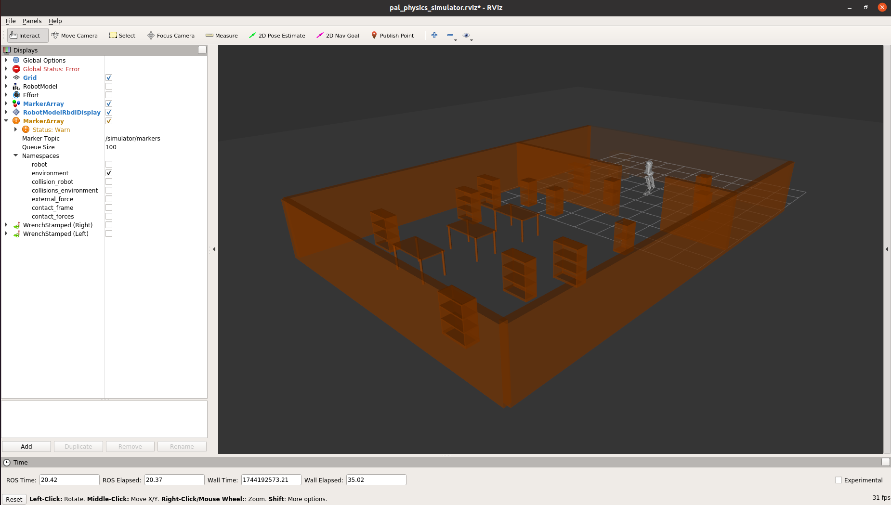

# PAL Physics Simulator

The *PAL Physics Simulator* is a custom simulator developed by PAL Robotics. Its purpose is to perform highly realistic simulations of the physics of the robot. In particular, it is highly recommended to use the *PAL Physics simulator* as simulation tool before testing any torque control experiments on the real robot.

## Start it

To launch the PAL Physics Simulator run the following command:
```
$ roslaunch kangaroo_pal_physics_simulator kangaroo_pal_physics_simulator.launch
```

The simulator uses *RViz* as a visualization tool.

## Start controllers

The *PAL Physics Simulator* has a plugin to use ROS control, and the behaviour is the same as launching the controllers in the real robot.

To start the position controllers, run the following command:
```
$ roslaunch kangaroo_controller_configuration position_controllers.launch
``` 

To start DCM controller run:
```
$ roslaunch kangaroo_pal_locomotion kangaroo_dcm_walking_controller.launch
```

## Simulated worlds

The *PAL Physics Simulator* allows to simulate virtual worlds that are translated as [Bullet](https://github.com/bulletphysics/bullet3) objects used for collision checking. These objects are simulated as immovable and represent fixed objects in the environment, and are intended to test just for collision properties.

The simulator parses most of the worlds represented in Gazebo as .world files.

The following example shows how to launch the *PAL Physics Simulator* specifying a world and providing a starting position for the robot.

```xml
<?xml version="1.0" encoding="UTF-8"?>
<launch>

  <arg name="robot" value="full_v2"/>

  <arg name="world" value="$(find pal_gazebo_worlds)/worlds/memmo_simple.world"/>

  <include file="$(find kangaroo_pal_physics_simulator)/launch/kangaroo_pal_physics_simulator.launch" >
    <arg name="world" value="$(arg world)"/>
  </include>
  
  <rosparam param="default_floating_base_pose/position">[-0.2, 0.25, 1.2]</rosparam>
  <rosparam param="default_floating_base_pose/orientation/x">0.0</rosparam>
  <rosparam param="default_floating_base_pose/orientation/y">0.0</rosparam>
  <rosparam param="default_floating_base_pose/orientation/z">0.0</rosparam>
  <rosparam param="default_floating_base_pose/orientation/w">1.0</rosparam>

</launch>
```

The starting position of the robot must be specified after including file in order to overwrite the default starting position of the robot in the world.

The world is published in *RViz* as a `visualization_msgs::MarkerArray` msg in the `/simulator/markers` topic, in the `odom` frame. The `odom` frame is published once the default controllers or the DCM controller are launched.



## Simulation tools

The *PAL Physics Simulator* offers some tools that allow to extract information of the environment as well as to apply some external forces on the robot.

The `/simulator/floating_base_state` topic retrieves the floating base pose of the robot in the simulation.

The `/simulator/external_wrench`topic allows to apply external forces on the robot as it does the  rosservice `/gazebo/apply_body_wrench` of Gazebo.

## Robot models

The *PAL Physics simulator* has different internal robot models that are published as *RobotModelRBDLDisplay* and *RobotModels*. These models show the internal state of the robot of the simulator and the controller.

- `/biped_walking_dcm_controller/joint_states` publishes the internal state of the DCM controller with the estimator.
- `/simulator/joint_states` publishes the internal state of the simulator.
- *RobotModel* uses the description of the *tf* and the robot state publisher to show the current state of the robot.

