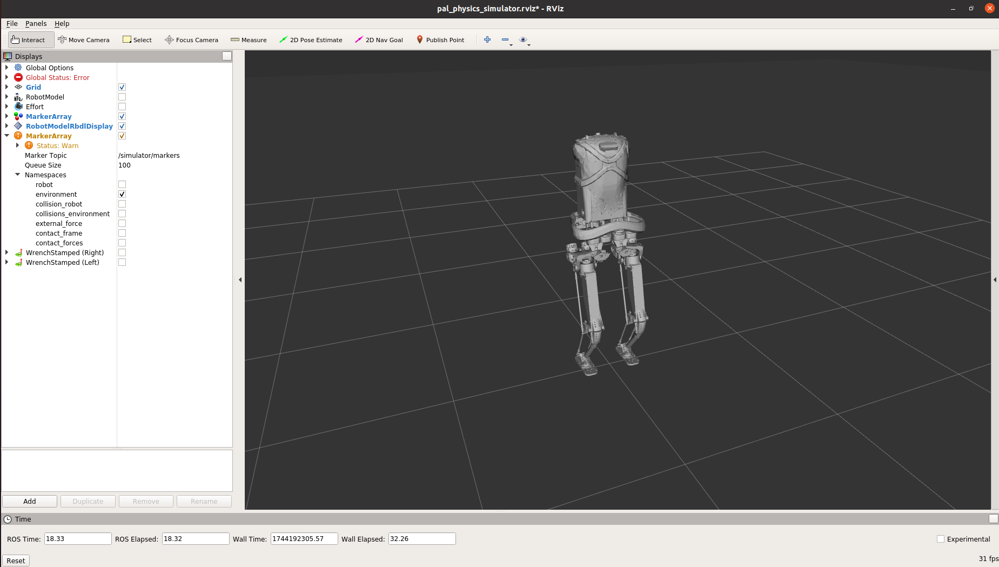

# PAL Physics Simulator

PAL's physics simulator for the robot. Test torque control here before the real robot.

## Start it

To launch the PAL Physics Simulator run the following command:
```
$ roslaunch kangaroo_pal_physics_simulator kangaroo_pal_physics_simulator.launch
```

The simulator uses *RViz* as a visualization tool.



## Start controllers

The *PAL Physics Simulator* has a plugin to use ROS control, and the behaviour is the same as launching the controllers in the real robot.

To start the position controllers, run the following command:
```
$ roslaunch kangaroo_controller_configuration position_controllers.launch
``` 

To start DCM controller run:
```
$ roslaunch kangaroo_pal_locomotion kangaroo_dcm_walking_controller.launch
```

## Worlds

Pass `world:=<file>.world` to the launch file. Worlds are fixed collision objects, published
as markers on `/simulator/markers`. Set the robot's start pose with
`default_floating_base_pose/position` and `default_floating_base_pose/orientation/{x,y,z,w}`
in a wrapper launch file, after the include.

## Simulation tools

The *PAL Physics Simulator* offers some tools that allow to extract information of the environment as well as to apply some external forces on the robot.

The `/simulator/floating_base_state` topic retrieves the floating base pose of the robot in the simulation.

The `/simulator/external_wrench`topic allows to apply external forces on the robot as it does the  rosservice `/gazebo/apply_body_wrench` of Gazebo.

## Topics

| Topic | Content |
| --- | --- |
| `/simulator/joint_states` | Simulator joint state (500 Hz). Use it as `joint_state_topic:=` for the policy. |
| `/simulator/floating_base_state` | Floating base pose. |
| `/simulator/external_wrench` | Apply an external force to the robot. |

## Reset

```bash
rosservice call /pal_physics_simulator/reset_world
```